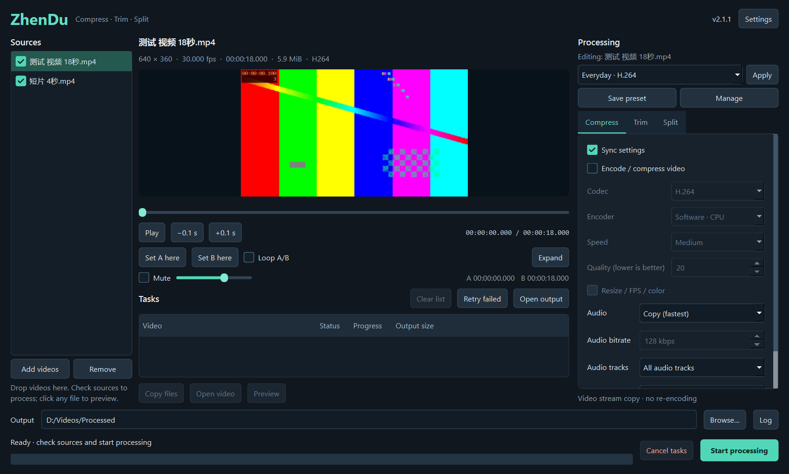
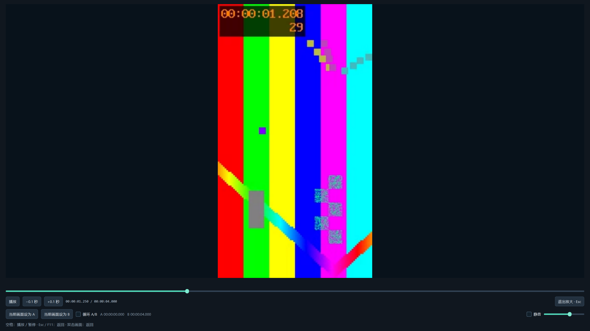

<p align="center"></p>
<h1 align="center">ZhenDu · 帧渡</h1>
<p align="center">A Windows video compressor, trimmer and splitter<br>Audio preview · Saved presets · Explorer context menu · PySide6</p>
<p align="center"><a href="README.md">简体中文</a> · <b>English</b> · <a href="https://github.com/Xingkong3027/ZhenDu/releases/latest">Download</a> · <a href="https://github.com/Xingkong3027/ZhenDu/issues">Report an issue</a></p>

Preview, trim, split and compress videos in one window. Trim a range and split it in the same task, copy encoded video when compression is disabled, and save settings as presets available from a video's Explorer context menu.



## Contents

- [Features](#features)
- [Download and run](#download-and-run)
- [Quick start](#quick-start)
- [Multiple sources and synchronized settings](#multiple-sources-and-synchronized-settings)
- [After processing](#after-processing)
- [Preview and shortcuts](#preview-and-shortcuts)
- [Compression, trimming and splitting](#compression-trimming-and-splitting)
- [Saved presets](#saved-presets)
- [Explorer context menu](#explorer-context-menu)
- [Language, settings and upgrades](#language-settings-and-upgrades)
- [Troubleshooting](#troubleshooting)
- [Run and build from source](#run-and-build-from-source)
- [Tests and releases](#tests-and-releases)
- [License and feedback](#license-and-feedback)

## Features

| Feature | Details |
| --- | --- |
| Batch tasks | Add or drop videos, check files to process, view queue progress and logs, cancel work and retry failures |
| Preview with audio | Playback, volume, mute, seeking, A/B markers and looping; trim settings are remembered per source |
| Expanded preview | Centered, aspect-preserving full-screen video with persistent controls and current/total time; returning preserves playback position and state |
| Video encoding | H.264, H.265/HEVC, VP9 and AV1; CPU and supported NVIDIA NVENC, Intel QSV or AMD AMF hardware |
| Picture settings | Quality, speed, dimensions, frame rate and color range; ignored when video encoding is disabled |
| Audio and containers | Copy, encode or remove audio; select a track and optionally keep subtitles; automatic, MP4, MKV, WebM, MOV and TS containers |
| Trim and split | Enable both together: trim first, then split the selected range by count, duration or target MiB |
| Stream copy | Preserve encoded video data without re-encoding; changing audio alone does not re-encode video |
| Presets | Name, reorder, import and export presets; optionally include splitting rules, fixed A/B times and menu visibility |
| Languages | Simplified Chinese, English or automatic selection; changes apply immediately |

## Download and run

1. Open [Releases](https://github.com/Xingkong3027/ZhenDu/releases/latest).
2. Download `ZhenDu-<version>-windows-x64-portable.zip`. **One package includes both Simplified Chinese and English.**
3. Extract the entire archive into a writable folder and run `ZhenDu.exe`.

Python is not required. Keep `_internal`, `ffmpeg` and the license files beside the executable; move the whole folder together. GitHub's automatic `Source code` downloads and `ZhenDu-<version>-source.zip` contain source, not a ready-to-run program.

The target is **64-bit Windows 10/11**. Local desktop validation used Windows 10 22H2. Hardware encoding needs compatible hardware and drivers. There is currently no installer, automatic updater, digital signature, or macOS/Linux release.

Compare downloads with `SHA256SUMS.txt` on the release page. In PowerShell: `Get-FileHash .\ZhenDu-2.1.1-windows-x64-portable.zip -Algorithm SHA256`.

## Quick start

1. **Add sources:** use the left list or drop files into the window. Check videos to process and select any source to preview it.
2. **Choose operations:** configure compression, trimming and splitting on the right. Switches are independent; disable video encoding for stream copy.
3. **Set the range:** enter A/B start and end times for trimming; select count, duration or size for splitting.
4. **Choose output:** the directory and task buttons stay at the bottom. Cancel is available while processing; it becomes **Copy files** when the queue finishes. Videos are saved directly by default; an empty directory saves beside the source.
5. **Start:** follow the queue and expand the log for details. A failed task does not block later tasks.

**Create a subfolder for each task** in Settings is **off by default**. Videos go straight into the selected directory, or beside the source if none is selected. No extra output folder or JSON file is left there. For example, `video.mp4` produces `video_ZhenDu.mp4`; existing names receive a numeric suffix and are never overwritten. Splitting produces multiple numbered videos directly.

Enable the setting to retain the previous layout: separate task subfolders, under `帧渡输出` beside the source when no directory is selected. Successful/failed task records use `task.json`/`task.failed.json` inside those folders. With the setting off, records live under `tasks` in the application settings directory instead. Cancelled or failed jobs clean up their own temporary outputs. Queued jobs retain the output mode selected when they were added.

## Multiple sources and synchronized settings

With multiple sources, each processing tab shows its own **Sync settings** switch. **Editing** identifies the source whose settings are displayed.

| Tab | Default sync | Behavior |
| --- | --- | --- |
| Compress | On | Share encoding, picture, audio and container settings across all sources |
| Trim | Off | Remember each source's enable switch and A/B times separately |
| Split | Off | Remember each source's enable switch, mode and parameters separately |

Enabling synchronization copies the **current source's settings for that tab** to every source, including unchecked sources. Later edits remain synchronized. Disabling it preserves the current values for individual editing. Unfinished time text survives source switches. Sync preferences persist; source lists and their drafts remain in the current session rather than becoming cross-file presets.

For example, share compression while trimming source A to 2–8 seconds and splitting it into two parts, and trimming B to 1–3 seconds without splitting. Each job receives its own range and split rule. Newly added sources inherit only synchronized settings; by default they do not inherit another source's trim/split setup. An empty B means each video's own end.

Before submission, all checked sources are validated, and invalid settings identify the affected file without submitting a partial batch. Queued jobs retain their captured settings. Explorer preset commands explicitly apply that preset to all files passed in that request.

**Successful sources are removed automatically**, while task results remain available for copying/opening/preview. **Failed sources remain unchecked and red**; hover or view the log for details, edit and check again, or retry with the failed job's original parameters. Cancelled sources remain unchecked. Retrying or manually correcting and resubmitting marks the old failure as resubmitted, so old parameters are not retried repeatedly.

Each new round starts at 0 and counts only its own jobs, including jobs appended while it is active. Historical tasks no longer make a new round start at 50%. Completion/failure/cancellation counts also refer to that round. The bottom Copy files button copies only successful results from that round; select historical videos in the queue to copy them. A failed/cancelled round cannot accidentally copy older results.

The task queue's **Output size** column updates bytes written about every half second during processing and shows actual file sizes on completion. Split-task parents show the total; expand them for individual parts. Hover for exact bytes. In size-based splitting, `↑` indicates that a part has exceeded its target; hover for the target and largest part. A total above the per-part target alone does not trigger this indicator.

Live sizes describe current writes, **not a final-size prediction or an automatic stop condition**. Finalizing the container or retrying a size-based split can change the value. Analysis files and duplicate encoding/remux copies of one part are not counted twice. Failed/cancelled tasks show `—`, so cleaned-up temporary data is not mistaken for retained output.

**Clear list** beside the queue is available only after all tasks stop. It remains disabled while tasks are queued, running or still cancelling. It clears task records, result selection and progress, keeping video files and the source list. Open older results from disk after clearing.

Disabled splitting grays out its parameters and help text. Count mode shows only part count, duration mode only duration, and size mode only size plus conservative verification. Both preview timelines support clicking or dragging anywhere on the groove, preserving playback/pause state.

## After processing

The bottom **Copy files** button copies every successful video from the current round, including all split parts. Press **Ctrl+V** in File Explorer or another application that supports pasting files. The Windows file clipboard requests a copy, keeping original outputs in place; support in other applications depends on the recipient.

Completed tasks expand to show their output files. Select a task row for all its outputs, or select an individual video. Ctrl/Shift enables multiple selection; selecting a parent and its child does not duplicate a file.

| Action | How |
| --- | --- |
| Copy selected results | **Copy files** below the queue, the context menu, or Ctrl+C while the queue has focus |
| Open video | **Open video** uses the system's default player; choose a specific file when several are selected |
| Preview in ZhenDu | **Preview**, the context menu, or double-click an output-file row; audio, seeking and expanded view are available |
| Return to a source | Click the left source list, even if that source is already selected; result preview preserves its trim times and processing settings |
| Open the output directory | Select a task or output file and click **Open output** |

Result preview uses the full video range and temporarily disables A/B editing. Returning to a source restores editing. Moved/deleted files produce a message, and failed copying leaves the previous clipboard intact. Starting another task restores **Cancel tasks**. Failed/cancelled tasks are excluded, while earlier successful results remain copyable.

## Preview and shortcuts

Qt Multimedia plays audio and video through one player. Its bundled media runtime handles preview, so `ffplay.exe` is unnecessary. Processing uses separate command-line FFmpeg and ffprobe executables.

| Action | Control |
| --- | --- |
| Play/pause | Play button, or Space while the preview has focus |
| Seek | Arrow keys or ±0.1-second buttons; actual seeking depends on source and decoder |
| Mark trim points | Set the current frame as A or B, or enter a time |
| Review a range | Enable A/B looping |
| Expand | Expand button or F11 |
| Return | Exit expanded view, Esc, F11, or double-click the picture |
| Sound | Volume slider and mute checkbox |

Expanded view keeps the timeline, playback, sound, A/B and looping controls at the bottom. Time uses `hours:minutes:seconds.milliseconds`. Landscape and portrait sources retain their aspect ratio, with unused space around them. Entering or leaving does not reopen the source.



## Compression, trimming and splitting

### Encoding off: fast stream copy

FFmpeg uses `-c:v copy` when video encoding is disabled, avoiding video re-encoding quality loss. Container data, timestamps and file bytes may still change. Comparing whole-file SHA256 values does not establish picture quality.

**Stream-copy cuts depend on keyframes.** A requested start of 3.5 seconds can move to a nearby keyframe. Enable video encoding for precise boundaries or changes to dimensions, frame rate and color range. Encoding audio alone still permits video stream copy.

### Encoding on: choose for your playback target

- H.264 is useful when compatibility matters; H.265, VP9 and AV1 support depends on the device and encoder.
- Quality values do not specify a target size and cannot be compared directly between encoders. Try a short sample first.
- NVENC, QSV and AMF correspond to NVIDIA, Intel and AMD. The chosen hardware encoder is checked; failure is reported rather than silently selecting another encoder.
- The container must support the selected streams. If copied audio or subtitles are incompatible, try MKV, change audio settings or disable subtitle retention.

### Trim before splitting

With both switches enabled, splitting applies only to the A/B range. Choose a part count, duration or size. Size uses **MiB = 1,048,576 bytes**.

Keyframes and container overhead affect copied segment sizes. The approximate policy allows variation; the conservative policy validates outputs and fails if the limit cannot be met. Very small limits may be impossible. Equal size does not imply equal duration.

## Saved presets

Save configured settings under a name and choose whether to show the preset in Explorer, include splitting rules or save fixed A/B times. **A/B is excluded by default** to avoid using another video's range.

Preset management supports renaming, deletion, ordering, import and export. Built-in examples cover everyday H.264, H.265 archiving and fast size splitting. Custom names remain as entered when the UI language changes. Menu tasks combine the preset with clean defaults and do not inherit unsaved trim points.

## Explorer context menu

1. Put the portable application in a location you intend to keep.
2. Open Settings and choose **Register / repair menu**.
3. Right-click a video and expand the ZhenDu processing submenu to open the tool or run a marked preset.

Preset actions open the tool, queue the task and show progress. **Remove context menu** in Settings undoes registration. It affects only the **current Windows user**, needs no administrator rights and leaves the default video player unchanged.

On Windows 11, use **Show more options** to reach the traditional cascading menu. Register again after moving the application and remove the menu before deleting its folder.

Versions share one official menu; the last version explicitly registered takes ownership. An older version's normal removal protects a different owner's registration. Intentionally removing another version's menu through Settings prompts first. Normal-mode versions also share settings; use portable configuration for independent presets.

## Language, settings and upgrades

Settings provides automatic selection, `简体中文` and `English`. Automatic mode uses Simplified Chinese on Simplified or Traditional Chinese systems and English elsewhere. Its label shows the resolved language, such as `Automatic (English)`. A separate Traditional Chinese translation is not included.

Changes apply immediately and update the context menu owned by this version. Custom preset names are not translated.

Normal settings live in `%LOCALAPPDATA%\ZhenDu`. Create an empty `portable.flag` beside the EXE to use `user_data` instead; the folder must be writable. The two modes are independent. Export/import presets to migrate between them.

For upgrades, close the old application, extract the complete new package into a new folder, keep or import settings, and register the menu again if needed. Do not mix a new EXE with unrelated old DLLs. Older versions refuse to overwrite a newer configuration schema. Automatic migration from the earlier CustomTkinter tool is not implemented.

The application implements no accounts, cloud uploads or automatic updates. Logs may contain local paths and FFmpeg arguments. Review and redact them before sharing; private videos are not required for a report.

## Troubleshooting

**The EXE does not start or a DLL is missing.** Extract the full package with `_internal` and `ffmpeg`. Running inside the ZIP, moving only the EXE or mixing DLL versions can break startup.

**Preview has no sound, stutters or cannot play a format.** Check mute, volume and the default Windows audio device. Qt preview and command-line FFmpeg can support different formats. High-bitrate, 4K, HDR sources and drivers can affect decoding. Not every device has been measured. Compare with an ordinary H.264/AAC sample and report media details and redacted logs.

**Cut positions or sizes differ from the request.** Stream copy follows keyframes; use encoding for precise boundaries. Container overhead also affects size. See the processing notes above.

**The menu is missing or opens an older version.** Register/repair from the current application, use Show more options on Windows 11, register after moving the folder and mark presets for menu visibility.

**A black command window appears.** Official builds use the Windows GUI subsystem and hide FFmpeg/ffprobe consoles. Confirm the portable release came from this repository. A custom console build can behave differently.

**GPU encoding is unavailable.** Choose the correct backend and check driver/codec support. CPU encoding is a manual alternative. An option appearing in the UI does not prove the hardware supports it.

## Run and build from source

Validated toolchain: Windows x64, **Python 3.14.5**, **PySide6 6.10.2**, **PyInstaller 6.22.3**. Large FFmpeg executables, virtual environments, private settings and built packages are excluded from source control.

```powershell
git clone https://github.com/Xingkong3027/ZhenDu.git
cd ZhenDu
py -3.14 -m venv .venv
.\.venv\Scripts\python.exe -m pip install -r requirements.txt
.\.venv\Scripts\python.exe tools\fetch_ffmpeg.py
.\.venv\Scripts\python.exe video_tool_clip_player.py
```

The dependency helper downloads a pinned Gyan build from the official GitHub mirror, checks SHA256 and extracts the two required executables plus upstream license/build information. The first download is about 234 MiB and needs network access. Alternatively supply verified `ffmpeg/bin/ffmpeg.exe`, `ffmpeg/bin/ffprobe.exe`, `ffmpeg/LICENSE` and `ffmpeg/README.txt`. Confirm codecs and licenses when substituting a build.

```powershell
.\.venv\Scripts\python.exe tools\build.py
```

Run `dist/ZhenDu/ZhenDu.exe` and distribute the whole directory. Full FFmpeg binaries are retained without recompilation. Unused ffplay and extra upstream documentation/preset folders are omitted. Qt Multimedia's separate FFmpeg DLLs must remain. Build PATH is isolated to avoid incompatible DLLs from unrelated tools.

| Directory | Contents |
| --- | --- |
| `zhendu` | UI, player, settings, probing, processing and Windows integration |
| `tests` | Unit, real FFmpeg, Windows and preview checks |
| `tools` | Icon generation, dependency fetching, building and release verification |
| `assets` / `docs` | Icon, translations, screenshots and dependency sources |
| `video_tool_clip_player.py` | Entry point |

## Tests and releases

```powershell
.\.venv\Scripts\python.exe -B -m unittest discover -s tests -p "test_*.py"
.\.venv\Scripts\python.exe -B -m tests.integration work\integration
.\.venv\Scripts\python.exe -B -m tests.edge_integration work\edge "work\integration\media\测试 视频 18秒.mp4"
```

Video tests generate their own media. Registry tests use an isolated namespace and do not enable the production menu. After building, run `ZhenDu.exe --self-test report.json --test-video sample.mp4 --test-expanded` for player checks; those need a usable desktop and media devices.

GitHub Actions checks main-branch pushes and PRs. Version tags trigger tests, a Windows build, actual packaged-task checks, source archiving and asset verification before publication. FFmpeg is not recompiled. See [contribution/release instructions](CONTRIBUTING.md), [changes](CHANGELOG.md) and [validation scope](docs/VALIDATION.md).

## License and feedback

ZhenDu's own code uses **GPL-3.0-only**, with copyright held by its contributors; see [LICENSE](LICENSE). Dependencies retain their own terms and copyright. This project does not claim ownership of FFmpeg, Qt, Python or PyInstaller.

Command-line FFmpeg is Gyan's GPLv3 full build `2026-01-29-git-c898ddb8fe`, retaining the original binaries, license and build information. Notices and source locations for Qt/PySide6/Shiboken6, Qt media FFmpeg, Python and PyInstaller are in [THIRD_PARTY_NOTICES.md](THIRD_PARTY_NOTICES.md) and the [source index](docs/THIRD_PARTY_SOURCES.md). Replaceable Qt DLLs and license notices remain in releases.

Use [GitHub Issues](https://github.com/Xingkong3027/ZhenDu/issues) for bugs and ideas. Include version, Windows/GPU details, reproduction steps and a redacted log.
