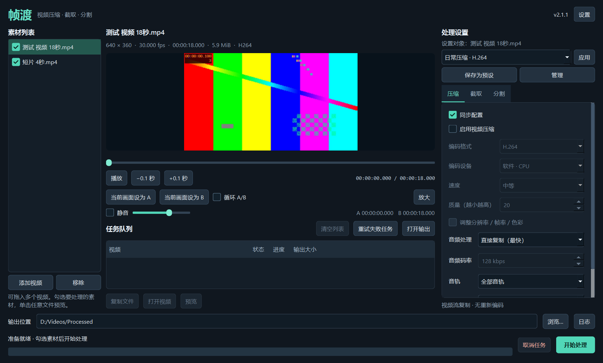

<p align="center"></p>
<h1 align="center">帧渡 · ZhenDu</h1>
<p align="center">Windows 视频压缩、截取与分割工具<br>有声预览 · 自定义预设 · 资源管理器右键菜单 · PySide6</p>
<p align="center"><b>简体中文</b> · <a href="README.en.md">English</a> · <a href="https://github.com/Xingkong3027/ZhenDu/releases/latest">下载最新版</a> · <a href="https://github.com/Xingkong3027/ZhenDu/issues">问题反馈</a></p>

帧渡把预览、截取、分割和压缩放在同一个窗口中。可以先截取一段，再将它分割；关闭视频压缩时使用流复制，避免重新编码视频。常用设置可以保存为预设，直接从视频文件的右键菜单启动。



## 目录

- [功能](#功能)
- [下载与运行](#下载与运行)
- [快速开始](#快速开始)
- [预览与快捷键](#预览与快捷键)
- [压缩、截取与分割](#压缩截取与分割)
- [自定义预设](#自定义预设)
- [资源管理器右键菜单](#资源管理器右键菜单)
- [语言、设置与升级](#语言设置与升级)
- [常见问题](#常见问题)
- [从源码运行与构建](#从源码运行与构建)
- [测试与发布](#测试与发布)
- [许可证与反馈](#许可证与反馈)

## 功能

| 功能 | 说明 |
| --- | --- |
| 批量任务 | 添加或拖入多个视频，勾选要处理的文件，查看队列、进度、日志，取消或重试失败任务 |
| 有声预览 | 播放／暂停、音量、静音、拖动定位、A/B 标记与循环，切换素材后重置截取范围 |
| 放大预览 | 按比例居中的全屏画面，持续显示控制栏、进度和当前／总时长；退出保留播放位置和状态 |
| 视频编码 | H.264、H.265/HEVC、VP9、AV1；CPU，以及相应设备支持的 NVIDIA NVENC、Intel QSV、AMD AMF |
| 画面选项 | 质量、速度、分辨率、帧率、色彩范围；未启用编码时忽略画面变换设置 |
| 音频与封装 | 复制／重新编码／去除音频，选择音轨，按选项保留字幕；自动、MP4、MKV、WebM、MOV、TS 封装 |
| 截取与分割 | 同时启用时先截取再分割；按段数、时长或目标 MiB 分割 |
| 流复制 | 关闭视频编码后保留视频编码数据；单独修改音频不会重新编码视频 |
| 保存预设 | 命名、排序、导入／导出，选择是否包含分割规则、固定 A/B 和右键菜单入口 |
| 双语界面 | 简体中文、English、按系统语言自动选择，切换后立即应用 |

## 下载与运行

1. 打开 [Releases](https://github.com/Xingkong3027/ZhenDu/releases/latest)。
2. 下载 `ZhenDu-<版本>-windows-x64-portable.zip`。**同一个便携包包含简体中文和 English。**
3. 将整个压缩包解压到可写目录，运行其中的 `ZhenDu.exe`。

无需另装 Python。请保留 EXE 旁的 `_internal`、`ffmpeg` 和许可证文件；移动时移动整个文件夹。GitHub 自动生成的 `Source code` 或 `ZhenDu-<版本>-source.zip` 是源码，不是可直接运行的程序。

支持目标为 **Windows 10／11，64 位**。本机实际验证环境为 Windows 10 22H2。硬件编码需要匹配的显卡和驱动。当前没有安装包、自动升级器、数字签名或 macOS／Linux 发行版。

发行页提供 `SHA256SUMS.txt`。可在 PowerShell 中运行 `Get-FileHash .\ZhenDu-2.0.1-windows-x64-portable.zip -Algorithm SHA256` 并与清单比较。

## 快速开始

1. **添加素材**：从左侧添加视频，或拖入文件。勾选要处理的文件；单击素材可预览。
2. **选择操作**：右侧配置压缩、截取、分割，三项独立启用。无需压缩时关闭视频编码。
3. **确认范围**：需要截取时设置 A/B 起止时间；分割时选择段数、时长或大小。
4. **选择输出位置**：底部始终显示输出目录、开始和取消按钮。默认直接输出视频，目录留空时保存在源视频所在目录。
5. **开始处理**：查看队列进度；展开日志检查过程。单个失败任务不阻止后续任务。

设置中的 **“为每个任务创建子文件夹”默认关闭**：直接向所选目录输出视频，未选择目录时保存在原视频旁，不额外创建输出文件夹或 JSON 文件。例如 `video.mp4` 生成 `video_ZhenDu.mp4`；重名时自动编号，绝不覆盖原文件。分割会直接生成多个带段号的视频。

开启该选项后保留原有目录结构：任务各有独立子文件夹；未选择输出目录时使用源视频旁的 `帧渡输出`。成功／失败记录分别保存在任务文件夹的 `task.json`／`task.failed.json`。关闭时记录保存于程序设置目录下的 `tasks`，不混入视频目录。取消或失败会清理本任务的临时输出；已排队任务保留加入队列时的输出方式。

## 预览与快捷键

预览采用 Qt Multimedia，音视频共用一个播放器。Qt 自带的媒体运行库负责预览，因此无需另带 `ffplay.exe`。视频处理使用另一组命令行 FFmpeg／ffprobe。

| 操作 | 方式 |
| --- | --- |
| 播放／暂停 | 播放按钮；预览获得焦点时按空格 |
| 向前／向后定位 | 方向键或 ±0.1 秒按钮；实际定位受素材与解码器影响 |
| 截取起止点 | 将当前画面设为 A 或 B，也可输入时间 |
| 循环检查 | 开启 A/B 循环 |
| 放大 | 点击“放大”，或使用 F11 |
| 退出放大 | “退出放大”按钮、Esc、F11，或双击画面 |
| 声音 | 音量滑块、静音选项 |

放大界面底部保留时间轴、播放／暂停、声音、A/B 和循环控制。时间显示为 `时:分:秒.毫秒`。横屏和竖屏视频均保持比例，剩余区域留边；进入／退出不重新打开素材。


## 压缩、截取与分割

### 不压缩：优先速度，保留视频编码数据

关闭视频压缩后使用 FFmpeg `-c:v copy`，不产生视频重新编码的质量损失。封装、时间戳和整个文件的字节仍可能变化，不能通过比较整个输出与源文件的 SHA256 判断画质。

**流复制切割边界受关键帧限制。** 例如从 3.5 秒开始，实际边界可能落在邻近关键帧。需要精确边界、改变分辨率／帧率／色彩范围时启用视频编码。只重新编码音频仍可复制视频。

### 压缩：按用途选择编码器

- H.264 通常适合兼容性优先的文件；H.265、VP9、AV1 的播放和编码支持取决于设备。
- 质量值不等于目标文件大小，不同编码器的数值不能直接比较。建议先试编码短片。
- NVENC／QSV／AMF 分别对应 NVIDIA／Intel／AMD。程序检查所选硬件编码器，失败时报告错误，不悄悄切换编码器。
- 封装必须支持选定的音视频和字幕。流复制报封装不兼容时，可改用 MKV、修改音频选项或关闭字幕保留。

### 截取后再分割

两项同时启用时，只分割选定的 A/B 范围。可按固定段数、每段时长或目标大小分割。大小单位是 **MiB = 1,048,576 字节**。

流复制时，关键帧和封装开销影响实际大小；“接近目标”允许误差。“保守”策略在输出后验证，无法满足限制时报告失败。极小上限未必能实现；相同大小也不代表相同时长。

## 自定义预设

配置好参数后点击“保存为预设”，输入名称，并选择是否在右键菜单显示、是否包含分割规则、是否保存固定 A/B 时间。**默认不保存 A/B**，避免误用上一个视频的范围。

管理界面支持重命名、删除、排序、导入和导出。内置日常 H.264、高清 H.265 与快速大小分割示例。自定义名称按输入保留，不随语言翻译。右键任务从预设和干净默认值开始，未保存的 A/B 不会继承。

## 资源管理器右键菜单

1. 把便携程序放在打算长期保留的位置。
2. 在“设置”中选择“注册／修复菜单”。
3. 对视频文件右键，展开“通过 帧渡 处理”，打开工具或运行已勾选的预设。

预设入口会打开工具、排入任务并显示进度。“撤销右键菜单”可移除注册。注册仅影响 **当前 Windows 用户**，不需要管理员权限，不改变默认播放器。

Windows 11 通过 **“显示更多选项”** 访问传统级联菜单。程序移动后需重新注册；删除便携目录前先撤销菜单，避免留下失效路径。

多个版本共用一份正式菜单，最后主动注册的版本接管。旧版本常规撤销会保护其他版本的注册；设置中如主动移除其他版本菜单，会明确提示。普通模式的不同版本也共用设置，需要独立预设时可使用便携配置。

## 语言、设置与升级

| 语言选项 | 行为 |
| --- | --- |
| 自动选择 | 简体或繁体中文系统使用简体中文，显示“自动选择(简体中文)”；其他系统使用 English，显示 `Automatic (English)` |
| 简体中文 | 固定中文 |
| English | 固定英文 |

切换立即应用，也更新当前版本持有的右键菜单。自定义预设名不翻译。本版本没有单独的繁体中文翻译。

普通设置位于 `%LOCALAPPDATA%\ZhenDu`。在 EXE 同目录创建空文件 `portable.flag`，可以改用 `user_data` 子目录；目录必须可写。两种模式配置独立，可通过预设导出／导入迁移。

升级时关闭旧程序，将新版完整解压到新目录，保留或导入设置，并按需重新注册菜单。不要只复制 EXE 混用旧运行库。旧版遇到更高格式的配置会拒绝覆盖。当前没有自动导入旧 CustomTkinter 版本配置的功能。

应用不实现账号、云端上传或自动更新。日志可能包含本地文件路径和 FFmpeg 参数；反馈前检查并删除个人信息，不必提交私人视频。

## 常见问题

**无法启动或提示 DLL 丢失？** 完整解压便携包，保留 `_internal` 和 `ffmpeg`。直接在压缩包内运行、单独移动 EXE、混用旧 DLL 都可能导致失败。

**预览无声、卡顿或不能播放？** 检查静音、音量和 Windows 默认音频设备。Qt 预览与命令行 FFmpeg 处理的格式支持可能不同。4K、HDR、高码率或驱动可能影响性能，目前未覆盖所有设备。可用普通 H.264/AAC 短片对比，并反馈素材信息和脱敏日志。

**切割位置或大小有误差？** 流复制依赖关键帧；精确时间边界请启用视频编码。大小还受封装开销影响，见上文处理说明。

**右键菜单缺失或打开旧程序？** 在当前程序中注册／修复；Windows 11 查看“显示更多选项”；移动程序后重新注册。预设需勾选显示到菜单。

**处理时弹出黑色窗口？** 正式版使用 Windows 图形程序类型，FFmpeg／ffprobe 统一隐藏控制台启动。请确认运行本仓库正式便携版；自定义控制台打包可能改变此行为。

**GPU 编码不可用？** 选择匹配的后端并确认驱动支持对应格式。CPU 软件编码可作为手动替代。菜单里出现选项不代表本机具备该编码能力。

## 从源码运行与构建

已验证工具链：Windows x64、Python **3.14.5**、PySide6 **6.10.2**、PyInstaller **6.22.3**。源码仓库不包含大型 FFmpeg EXE、虚拟环境、个人设置或生成的便携包。

```powershell
git clone https://github.com/Xingkong3027/ZhenDu.git
cd ZhenDu
py -3.14 -m venv .venv
.\.venv\Scripts\python.exe -m pip install -r requirements.txt
.\.venv\Scripts\python.exe tools\fetch_ffmpeg.py
.\.venv\Scripts\python.exe video_tool_clip_player.py
```

依赖获取脚本从 Gyan 官方 GitHub 镜像下载固定版本，验证 SHA256，再提取两个程序及上游许可／构建信息；首次下载约 234 MiB，需要联网。也可自行准备 `ffmpeg/bin/ffmpeg.exe`、`ffmpeg/bin/ffprobe.exe`、`ffmpeg/LICENSE`、`ffmpeg/README.txt`；替换版本时自行确认编码器与许可。

```powershell
.\.venv\Scripts\python.exe tools\build.py
```

构建结果是 `dist/ZhenDu/ZhenDu.exe`，分发整个目录。保留 FFmpeg 完整二进制，不重新裁剪编译；省略未调用的 ffplay 和多余文档／预设目录。Qt Multimedia 的 FFmpeg DLL 仍需保留。构建隔离无关 PATH，避免混入不相容 DLL。

| 目录 | 内容 |
| --- | --- |
| `zhendu` | 界面、播放器、配置、媒体探测、任务与 Windows 集成 |
| `tests` | 单元、真实 FFmpeg、Windows 和预览测试 |
| `tools` | 图标生成、依赖获取、构建、发布核验 |
| `assets` / `docs` | 图标、翻译、截图和第三方来源 |
| `video_tool_clip_player.py` | 程序入口 |

## 测试与发布

```powershell
.\.venv\Scripts\python.exe -B -m unittest discover -s tests -p "test_*.py"
.\.venv\Scripts\python.exe -B -m tests.integration work\integration
.\.venv\Scripts\python.exe -B -m tests.edge_integration work\edge "work\integration\media\测试 视频 18秒.mp4"
```

视频测试生成自己的素材，不需要私人文件。注册表测试使用独立位置，不启用正式菜单。打包后可执行 `ZhenDu.exe --self-test report.json --test-video sample.mp4 --test-expanded`；播放器诊断需要可用桌面及媒体设备。

GitHub Actions 检查主分支和 PR。版本标签触发测试、Windows 构建、实际 EXE 任务验证、源码归档和附件核验，通过后发布；不重新编译 FFmpeg。见 [贡献与发布说明](CONTRIBUTING.md)、[更新记录](CHANGELOG.md) 和 [验证范围](docs/VALIDATION.md)。

## 许可证与反馈

帧渡自身代码使用 **GPL-3.0-only**，见 [LICENSE](LICENSE)，版权归各贡献者所有。第三方组件保留各自的版权和许可，本项目不声称拥有 FFmpeg、Qt、Python 或 PyInstaller。

命令行 FFmpeg 来自 Gyan 的 GPLv3 完整构建 `2026-01-29-git-c898ddb8fe`。原始二进制、许可与构建说明保持不变。Qt／PySide6／Shiboken6、Qt 媒体 FFmpeg、Python 和 PyInstaller 的许可与源码见 [第三方声明](THIRD_PARTY_NOTICES.md) 和 [第三方源码索引](docs/THIRD_PARTY_SOURCES.md)。发行包保留可替换的 Qt DLL 和许可文件。

请在 [GitHub Issues](https://github.com/Xingkong3027/ZhenDu/issues) 提交问题，附版本、Windows／显卡信息、复现步骤及脱敏日志。
